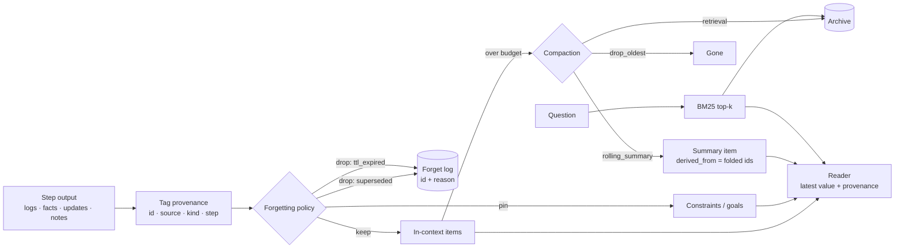

# context-lifecycle

Context management for long-running agents: three compaction strategies (rolling summary, drop-oldest, retrieval-backed archive), provenance tags on every context item, and an explicit forgetting policy that says what to retain and what to drop — evaluated on long multi-step tasks as **accuracy vs tokens used**.

> All numbers below come from `results/eval.json`. The tasks are **synthetic**, the summarizer is a **mock** (extractive, budget-capped, 3% loss per pass), and the reader is **deterministic code, not an LLM**. The eval measures what each strategy *keeps*, not how a model reasons over it.

## What it is
- `items.py` — `ContextItem` with mandatory provenance: `id`, `source` (user/tool/agent/summary), `kind`, `step`, `derived_from` (ids a summary was built from). Regex token counter.
- `strategies.py`
  - `Full` — no compaction (accuracy ceiling, cost ceiling).
  - `DropOldest(budget)` — evict oldest items until under budget.
  - `RollingSummary(budget)` — fold the oldest half of the budget into one summary item (latest value per fact, `[as of step N]` tags, capped at budget/3 tokens).
  - `RetrievalArchive(budget, k=4)` — evicted items go to an archive (nothing lost); BM25 top-k is pulled back in only when a question is asked.
  - `ForgettingPolicy` — composable with any strategy; every drop is logged with a reason.
- `tasks.py` — 200-step tasks: tool logs (50–110 words of noise with lexical distractors), new facts, updates that supersede old facts, facts buried inside logs (40%), user constraints at step 0, 6 questions every 25 steps.
- `reader.py` — answers "What is the A for E?" from visible context; the value with the highest step wins; returns the provenance of the item it used.

## Why
Long-running agents hit the context wall. The usual fixes — truncate, summarize, retrieve — each lose something different. Truncation loses the original goal; summaries compound loss; retrieval surfaces stale values next to fresh ones. An explicit forgetting policy (drop superseded facts, expire noise, pin constraints) is cheap and composes with all three. This repo puts numbers on those trade-offs.

## Architecture


## How it works
**Forgetting policy (explicit rules):**

| Rule | Action | Reason tag |
|---|---|---|
| User constraints and goals | RETAIN — pinned, never evicted or summarized | — |
| Latest value of each fact key | RETAIN | — |
| Item whose facts are all superseded by a newer value | DROP | `superseded` |
| Tool log / agent note with no facts, older than 3 steps | DROP | `ttl_expired` |

Across the 20 × 200-step runs of `drop_oldest+policy` at budget 1000, the policy logged 262 `superseded` and 7,090 `ttl_expired` drops.

**Provenance:** raw items carry their own step and source; a summary item's `derived_from` lists every item id it absorbed (transitively through earlier summaries); the reader returns the provenance of the item behind each answer, so an answer can always be traced to a step.

## Results (SYNTHETIC, 20 seeds × 200 steps, 960 questions per row)
"ctx tokens/step" = mean visible context per step (what an agent pays every call). "tokens/question" = context visible when answering (includes retrieved items). Stale = answered with a superseded value; missing = no value found.

| strategy | budget | accuracy | stale | missing | constraint acc | updated acc | static acc | ctx tokens/step | tokens/question |
|---|---|---|---|---|---|---|---|---|---|
| full | ∞ | 1.000 | 0.000 | 0.000 | 1.000 | 1.000 | 1.000 | 11378 | 12732 |
| drop_oldest | 1000 | 0.138 | 0.000 | 0.863 | 0.000 | 0.184 | 0.140 | 942 | 956 |
| rolling_summary | 1000 | 0.536 | 0.000 | 0.464 | 0.181 | 0.631 | 0.576 | 702 | 698 |
| retrieval | 1000 | 0.733 | 0.107 | 0.159 | 1.000 | 0.659 | 0.709 | 942 | 1025 |
| drop_oldest+policy | 1000 | 0.502 | 0.000 | 0.498 | 1.000 | 0.395 | 0.412 | 895 | 933 |
| rolling_summary+policy | 1000 | 0.724 | 0.000 | 0.276 | 1.000 | 0.682 | 0.650 | 757 | 792 |
| retrieval+policy | 1000 | 0.980 | 0.000 | 0.020 | 1.000 | 0.970 | 0.985 | 895 | 1070 |
| drop_oldest | 2000 | 0.243 | 0.000 | 0.757 | 0.000 | 0.304 | 0.273 | 1882 | 1958 |
| rolling_summary | 2000 | 0.796 | 0.000 | 0.204 | 0.506 | 0.858 | 0.849 | 1433 | 1508 |
| retrieval | 2000 | 0.774 | 0.094 | 0.132 | 1.000 | 0.700 | 0.768 | 1882 | 2027 |
| drop_oldest+policy | 2000 | 0.797 | 0.000 | 0.203 | 1.000 | 0.760 | 0.751 | 1651 | 1750 |
| rolling_summary+policy | 2000 | 0.948 | 0.000 | 0.052 | 1.000 | 0.937 | 0.938 | 1388 | 1460 |
| retrieval+policy | 2000 | 0.996 | 0.000 | 0.004 | 1.000 | 0.994 | 0.997 | 1651 | 1869 |
| drop_oldest | 4000 | 0.428 | 0.000 | 0.572 | 0.125 | 0.486 | 0.493 | 3632 | 3824 |
| rolling_summary | 4000 | 0.939 | 0.000 | 0.061 | 0.938 | 0.944 | 0.932 | 2820 | 2994 |
| retrieval | 4000 | 0.835 | 0.072 | 0.093 | 1.000 | 0.775 | 0.840 | 3632 | 3885 |
| drop_oldest+policy | 4000 | 0.997 | 0.000 | 0.003 | 1.000 | 0.998 | 0.994 | 2327 | 2541 |
| rolling_summary+policy | 4000 | 1.000 | 0.000 | 0.000 | 1.000 | 1.000 | 1.000 | 2280 | 2474 |
| retrieval+policy | 4000 | 1.000 | 0.000 | 0.000 | 1.000 | 1.000 | 1.000 | 2327 | 2549 |

What the numbers say (for this synthetic setup):
- **The forgetting policy is the biggest lever.** At every budget it raises every strategy, and it is what removes stale answers from retrieval (0.107 → 0.000 at budget 1000).
- **Drop-oldest without a policy loses the goal.** Constraint accuracy is 0.000 at budgets 1000 and 2000: the step-0 constraints are the first thing evicted.
- **Retrieval never loses a fact but returns stale ones.** Without the policy, BM25 often retrieves an old value and misses its update (stale 0.072–0.107).
- **retrieval+policy at budget 1000 reached 0.980 accuracy with ~1,070 tokens per question, vs 12,732 for full context** (~12× fewer tokens).
- Rolling summaries degrade at small budgets because the summary cap (budget/3) cannot hold every live fact, and each re-summarization pass drops 3% of triples.

Reproduce: `python -m context_lifecycle.evaluate` (~1 min).

## Tests
16 tests (`pytest -q`): provenance fields and unique ids, token counter and fact parsing, reader recency + provenance, each strategy's budget behaviour, policy pinning / supersede / TTL with reason logs, summary `derived_from` and size cap, archive retrieval, task determinism, full-context upper bound, policy gain over drop-oldest.

```bash
pip install pytest
python -m pytest -q
```

## Limits
- **No LLM anywhere.** A deterministic reader makes full context score 1.000 by construction; real models degrade on long contexts ("lost in the middle"), so the real gap between full and compacted context is likely smaller or reversed.
- The policy and the reader share the same fact pattern, so the policy's fact extraction is perfect here. A real policy needs an extractor that will make mistakes.
- The mock summarizer is extractive and loses 3% per pass; a real LLM summarizer paraphrases, merges and can hallucinate.
- Tokens are regex counts, not BPE tokens. Tasks are synthetic key-value facts; reasoning across facts is not tested.

## License
MIT
